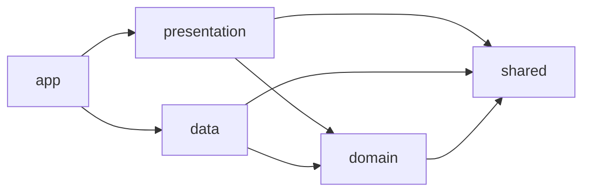

# Architecture

The app follows clean architecture, split by feature. Each feature has three layers.

## Folder Structure

```
index.html           # entry page, loads src/app/main.js
data/<album>/        # album data: raw/ is local only, tracks/ is committed (see data-guide.md)
notebooks/           # Python data prep; exports track data into data/<album>/tracks
src/
  app/               # composition root: wires the features together
  shared/            # cross-cutting utilities used by any layer
  features/
    album/           # albums, songs and their timelines
    cat/             # the Live2D black cat in the bottom right corner
    controls/        # player controls and the more menu
    docent/          # spoken and written descriptions (accessibility)
    globe/           # the globe and its data views
    info/            # the onboarding, the About and License dialogs and what they say
    music/           # data-to-sound mapping and the audio engine
    tracks/          # NASA data loaded as time series on the globe
    turntable/       # the turntable and record visuals
      <feature>/
        domain/        # pure logic and models
        data/          # data sources, stores, audio engine, static datasets
        presentation/  # DOM, canvas and three.js views
```

## Dependency Rules



- `domain` imports only other `domain` code and `shared`. It never touches the DOM, Web Audio, `fetch` or storage.
- `data` and `presentation` depend on `domain`, never on each other.
- A feature may import another feature's `domain`. It does not import another feature's `data` or `presentation`.
- Only `app` wires features together across `data` and `presentation`.
